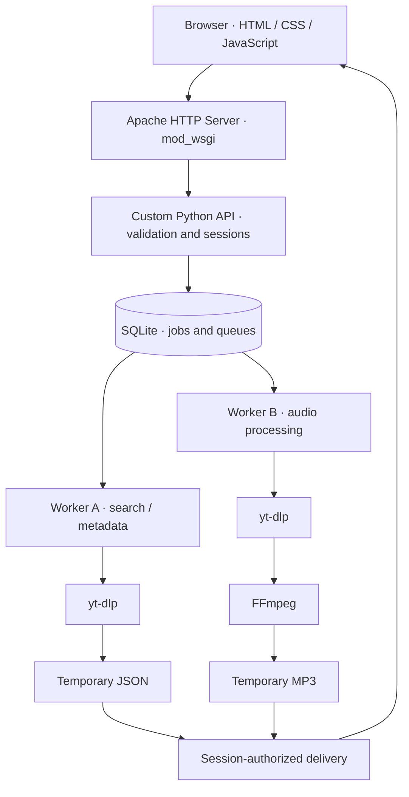

<h1>WripYT</h1>

<strong>A self-hosted FOSS Python web application for YouTube audio extraction and MP3 conversion using yt-dlp and FFmpeg.</strong>

  
  
  
  
  
  

  
  

  <a href="#overview">Overview</a> ·
  <a href="#planned-features">Features</a> ·
  <a href="#architecture">Architecture</a> ·
  <a href="#development-environment">Development</a> ·
  <a href="#notes">Notes</a>

WripYT is designed as a lightweight, self-hosted web application with a custom Python API, a SQLite-backed job queue, and separate workers for searching and processing audio. It aims to give users a simple browser interface while keeping processing, resource limits, and temporary files under local control.

> [!IMPORTANT]
> **Work in progress.** This README describes the planned application and architecture. Features, deployment instructions, and performance have not yet been verified in a complete release.

## Overview

WripYT separates its web interface from background media-processing tasks. Requests are validated, associated with an anonymous session, and placed in a SQLite queue. Independent Python workers process search and conversion jobs. Results and MP3 files are held temporarily and delivered only to the originating session.

The design intentionally avoids web frameworks such as Flask, Django, and FastAPI. The HTTP API is planned as a custom Python application served by Apache HTTP Server with `mod_wsgi` in daemon mode.

## Planned features

- Search YouTube and display the first ten results, including titles and durations.
- Accept a direct YouTube video URL.
- Select from server-supported MP3 encoding bitrates.
- Display queue position, processing state, and measurable progress.
- Prepare audio on the server using yt-dlp and FFmpeg.
- Deliver the resulting MP3 through the browser.
- Enforce per-session and resource limits.
- Expire temporary results and media files automatically.

## Architecture

**Execution model:** One search job and one download job may run at a time initially. The workers claim jobs atomically from their respective SQLite queues; they are independent of Apache's HTTP request workers.

### Core components

| Component | Responsibility |
| --- | --- |
| Apache HTTP Server + `mod_wsgi` | Accept HTTP requests and run the custom Python WSGI API. |
| Python API | Validate input, manage sessions, enqueue jobs, and return responses. |
| SQLite | Store job state, queue metadata, and session associations. |
| Search worker | Retrieve authorized search and video metadata through yt-dlp. |
| Download worker | Process permitted source media and convert audio with FFmpeg. |
| Temporary storage | Hold search JSON and processed media until expiration. |

### Engineering decisions

- **Custom API:** Implement the application interface using Python rather than a full web framework.
- **SQLite queues:** Keep job scheduling on one self-hosted machine without introducing a separate broker.
- **Separate workers:** Keep metadata searches independent from audio downloads and conversions.
- **Session isolation:** Restrict job status, cancellation, and file delivery to the session that submitted the request.
- **Bounded processing:** Apply request limits, timeouts, disk quotas, and automatic cleanup.
- **Temporary data:** Do not maintain a permanent catalog of YouTube results or retain processed MP3s indefinitely.

## Notes

### Development environment

| Item | Tool |
| --- | --- |
| Operating system | Fedora Linux |
| Editor | VSCodium |
| Editor extensions | Live Preview, Codex |
| Primary language | Python |
| Frontend | HTML, CSS, JavaScript |
| HTTP server | Apache HTTP Server (`mod_wsgi`, daemon mode) |
| Database | SQLite |
| Media tools | yt-dlp, FFmpeg |

**Project start:** October 18, 2026.

### Authorship

This project was conceived, architected, and developed under human direction, with its technical decisions and review overseen by me (@conradomr). Codex was used selectively as a coding tool to accelerate implementation.

### License

WripYT is licensed under the **GNU Affero General Public License v3.0 (AGPLv3)**. See the [official license text](https://www.gnu.org/licenses/agpl-3.0.en.html).

Only use the application for content you own or are authorized to download, in accordance with applicable rights and platform terms. yt-dlp and FFmpeg remain subject to their respective licenses.
